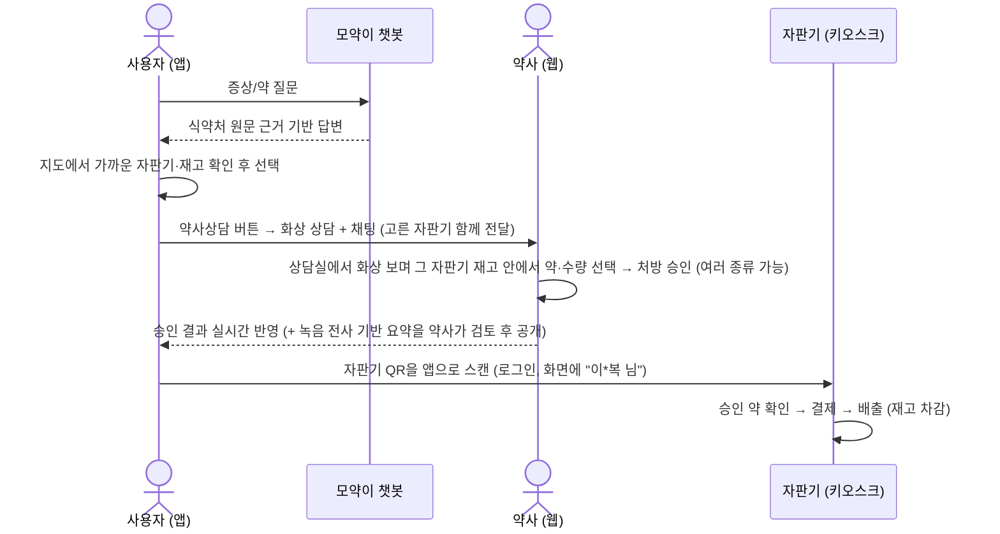

# MOYAK 모약 — 스마트 의약품 자판기 서비스

**MOYAK(모두의 약)** 은 AI 챗봇 상담 → 약사 화상 상담·처방 승인 → 자판기 수령까지 이어지는 스마트 의약품 자판기 서비스입니다.
이 저장소는 그 백엔드(FastAPI)와 시연용 웹 화면 3종(사용자 앱 · 약사 웹 · 자판기 키오스크)을 담고 있습니다.

> **핵심 원칙 — AI는 판매를 승인하지 않습니다.**
> 챗봇은 공식 자료(식약처 e약은요) 안에서만 안내하고, 어떤 약을 줄지는 항상 약사가 상담 후 직접 정해 승인합니다.
> 모든 승인·결제·수령 기록이 DB에 남습니다. (규제샌드박스 신청 근거 자료용 프로토타입)

## 🔗 바로 보기 (Render 배포)

| 화면 | 주소 | 설명 |
|---|---|---|
| 📱 사용자 앱 | https://moyak-backend.onrender.com | 스플래시부터 시작 (`/app/...`) |
| 🩺 약사 웹 | https://moyak-backend.onrender.com/pharmacist | 상담 대기 목록, 상담실(화상+채팅+처방), 처방 승인 |
| 🖥️ 자판기 키오스크 | https://moyak-backend.onrender.com/kiosk/start/ | 세로형 대형 터치스크린 (1080×1920) |
| 🧪 챗봇 테스트 | https://moyak-backend.onrender.com/chat-test | 답변/출처/원문 근거 확인용 |
| 📖 API 문서 | https://moyak-backend.onrender.com/docs | Swagger |

> Render 무료 인스턴스라 한동안 안 쓰면 첫 접속에 ~1분 걸립니다. 상담·승인·결제 기록은 팀 Supabase(Postgres)에 저장돼 재배포해도 남습니다.
> 모든 화면은 폰·PC 어느 크기에서도 화면에 맞게 축소되어 보입니다.

## 🎬 전체 시나리오



## ✨ 주요 기능

### 📱 사용자 앱 (`/app`)
- **모약이 챗봇 (RAG)**: e약은요 공공데이터 안에서만 답변하고, 실제 인용한 **식약처 원문**을 "근거 보기"로 그대로 보여줍니다.
  - 특정 약 질문 / **증상 기반 추천**(약마다 "💊 약 이름 → 추천 이유 → 성분 → 주의 1가지", 앱에서는 약별 카드) / **병용 안전성 확인**(명시 안 됨 ≠ 안전) /
    **임산부·소아·고령자 필터** / 후속 질문 맥락 유지 / 위험 질문 시 약사 상담 권유
  - (선택, `DRUG_DB_ENRICH=1`) **식약처 허가정보·DUR 보강**: 병용금기를 공식 목록으로 판정, 임부금기·노인주의 등 표시, e약은요에 없는 전문의약품 **3만여 개도 의미 검색**(약효분류·성분)으로 찾아 기본 정보 안내(처방 필요 안내, 복용법은 안내 안 함)
- **회원가입·로그인**: Supabase Auth 연동(아이디·비밀번호 + **실명**), 마이페이지에 "OOO 님" 표시
- **약사 화상 상담**: 하단 가운데 "상담하기" 버튼으로 챗봇 대화 없이 바로 입장, 또는 챗봇 대화 내용을 약사에게 전달하며 요청
  - 화상(Daily.co) 중 **💬 채팅**, 양측 동의 시 **자동 녹음·전사** → 약사가 검토·수정한 **6항목 요약** 공개
  - 지도에서 고른 자판기를 상담에 함께 보내, 그 자판기에서 바로 받을 수 있는 약으로 처방받음
  - 약사 승인/거절 결과가 3초 간격으로 자동 반영, **내 상담 내역**에서 처방약(× 수량)·요약 다시 보기
- **내 주변 자판기 지도**: 카카오 지도 + 가까운 순 목록(거리·도보 시간·재고 상태) → 자판기별 품목 재고 → 자판기 선택
- **전자 구매 허가서**(마이페이지), 온보딩/회원가입/권한 안내 화면 (Figma 디자인 기반)

### 🩺 약사 웹 (`/pharmacist`)
- 상담 대기 목록 (챗봇 대화 기록 또는 "직접 상담 요청", 환자가 고른 키오스크 표시)
- **🎥 상담실**: 한 화면에서 왼쪽 화상(크게) + 오른쪽 채팅·처방·녹음/요약
- **처방**: 환자가 고른 키오스크면 그 **재고 목록에서만** 선택(품절 불가, 판매가 자동), 아니면 약 자동완성 검색
  - **수량** −/+ (재고·10개까지, 금액 = 판매가 × 수량), **처방 목록**에 최대 5종류 담아 한 번에 승인 / 거절(사유)
- 녹음 전사 원문 확인, AI 요약 초안 검토·수정 후 공개, 처리 내역 탭

### 🖥️ 자판기 키오스크 (`/kiosk`)
- 시작 → 회원 QR 로그인(앱으로 스캔, 화면에 가린 실명 "이*복 님") 또는 비회원 의약외품 구매
- **회원**: 승인받은 약(여러 종류·수량)이 있으면 승인 약 확인(장바구니) → 결제 → 배출(재고 차감), 없으면 안내 홈
- **비회원**: 의약외품 목록 → 장바구니(수량/삭제) → 결제 → 배출
- 결제 완료 시 자동 로그아웃, 10분 무조작 시 장바구니 초기화/로그아웃 (공용 기기 보안)

## 🛠 기술 스택

| 영역 | 기술 |
|---|---|
| 데이터 소스 | 식약처 e약은요 공공데이터 API |
| 전처리 | Python + Pandas |
| 임베딩 / 벡터 DB | OpenAI `text-embedding-3-small` / Pinecone (1536, cosine) |
| LLM | GPT-4o (temperature 0.2), 질문 분류·재작성·상담 요약은 GPT-4o-mini |
| 체인 | LangChain |
| API 서버 | FastAPI (+ slowapi 요청량 제한) |
| 상담/결제/키오스크 DB | 팀 Supabase(PostgreSQL) — 로컬 개발은 SQLite (`DATABASE_URL`로 선택) |
| 회원가입·로그인 | Supabase Auth (+ 서버 서명 토큰) |
| 자판기 위치/재고·약 허가정보/DUR | Supabase (PostgreSQL + PostGIS) |
| 상담 녹음 전사·요약 | OpenAI `gpt-4o-mini-transcribe` / GPT-4o 구조화 출력 |
| 지도 | 카카오 지도 JavaScript API |
| 화상 상담 | Daily.co (Prebuilt) |
| 프론트 (시연용) | Figma → HTML/CSS 내보내기 + Vanilla JS |
| 배포 | Render (`master` 브랜치 푸시 시 자동 배포, 개발은 `dev` 브랜치) |

## 🧠 RAG 데이터 파이프라인

```
STEP 0 수집 → STEP 1 정제 → STEP 2 청킹 → STEP 3 임베딩 → STEP 4 인덱싱(Pinecone)
                                                                    │
                                        STEP 6 API 서버 ← STEP 5 RAG 체인
```

| STEP | 내용 | 결과 |
|---|---|---|
| 0 | e약은요 API 전체 수집 | 4,774건 |
| 1 | HTML 제거, 중복/결측 처리 | 4,757건 |
| 2 | 필드별(효능/사용법/경고/주의사항/상호작용/부작용/보관법) 청킹 | 27,956개 청크 |
| 3 | OpenAI 임베딩 | 27,956개 벡터 |
| 4 | Pinecone upsert | 인덱스 `moyak-eyakeunyo` |
| 5 | 질문 유형 분기(특정 약/증상/병용) + 검색 + GPT-4o 생성 | `src/rag/chain.py` |

## 📡 API 요약

전체 스펙은 `/docs`(Swagger)와 [`CLAUDE.md`](./CLAUDE.md) 참고. 프론트-백엔드 통신은 모두 JSON.

| 분류 | 엔드포인트 |
|---|---|
| 회원 | `GET /auth/username-available` · `POST /auth/signup` (`username`, `password`, `name`) · `POST /auth/login` · `GET·PATCH /auth/me` (실명) |
| 챗봇 | `POST /chat` (`question`, `history`) → `answer`, `sources`, `evidence`, `recommendations`(증상 추천일 때 약별) · IP당 15회/분, 200회/일 |
| 상담 | `POST /consultations` (`user_id`, `chat_summary`, `machine_code`) · `GET /consultations?status=&user_id=&pharmacist_id=` · `GET /consultations/{id}` · `POST /consultations/{id}/cancel` |
| 약사 결정 | `POST /consultations/{id}/decision` (`approve`, `items: [{drug_item_seq, drug_item_name, quantity, price}]` 또는 단일 필드, `reason`) → `approved_items` |
| 상담 채팅/요약 | `GET·POST /consultations/{id}/messages` · `POST /consultations/{id}/end` (즉시 요약) |
| 녹음·검토 요약 | `.../session/claim·consent·end` · `POST .../audio` · `GET .../transcript` · `GET .../summary` · `POST .../summary/publish·retry` |
| 약품 검색 | `GET /drugs/search?q=` (약사 자동완성) |
| 자판기 로그인 | `POST /vending/machines/{id}/rotate-qr` · `POST /vending/scan` · `GET /vending/machines/{id}/session` (`user_display_name` 가린 실명) |
| 키오스크 의약품 재고 | `GET /vending/machines/{code}/medicines` (약사 처방 목록용) |
| 승인 약 | `GET /vending/purchases?user_id=` · `POST /vending/purchases/pay` · `POST /vending/dispense` |
| 의약외품 | `GET /vending/machines/{id}/products` · `POST /vending/machines/{id}/orders` · `GET /vending/orders/{id}` · `POST /vending/orders/{id}/pay·cancel·dispense` (미결제 10분 지나면 자동 취소) |
| 지도 | `GET /api/v1/map/config` · `GET /api/v1/map/machines?lat=&lng=` · `GET /api/v1/map/machines/{id}` — [docs/map-api.md](./docs/map-api.md) |
| 기타 | `GET /health` |

## 🚀 로컬 실행

```bash
python -m venv .venv
.venv\Scripts\activate          # Windows
pip install -r requirements.txt
```

`.env.example`을 복사해 `.env`를 만들고 값을 채웁니다. **`.env`는 git에 올리지 않습니다.**

| 변수 | 용도 | 없으면 |
|---|---|---|
| `EYAK_SERVICE_KEY` | e약은요 데이터 수집 | 수집 스크립트만 불가 |
| `OPENAI_API_KEY` | 임베딩, 챗봇, 상담 요약 | 챗봇 불가 |
| `PINECONE_API_KEY` | 벡터 검색 | 챗봇 불가 |
| `DAILY_API_KEY` | 화상 상담방 생성 | 화상만 빠지고 상담은 동작 |
| `MAP_DATABASE_URL` | Supabase 자판기 위치/재고 (지도 전용, 읽기 전용) | 서버 DB의 시연용 가상 자판기 사용 |
| `KAKAO_JS_KEY` | 카카오 지도 (도메인 등록 필요) | 지도 대신 목록만 표시 |
| `DEMO_MAP_CENTER` | 지도 기본 중심 `위도,경도` | 동양미래대학교 |
| `DATABASE_URL` | 상담/결제/키오스크 DB (Render는 팀 Supabase) | `data/moyak.db` (SQLite) |
| `SUPABASE_URL` · `SUPABASE_ANON_KEY` · `SUPABASE_SERVICE_ROLE_KEY` | 회원가입·로그인 (service_role은 서버 전용 비밀값) | 가입·로그인 503 |
| `CONSULT_AUTH_SECRET` | 로그인 토큰 서명 (32자 이상 무작위) | 로그인 토큰 발급 불가 |
| `DRUG_DB_ENRICH` | `1`이면 챗봇에 식약처 허가정보·DUR 보강 | 보강 없이 e약은요만 |

> ⚠️ 로컬 개발은 SQLite를 권장합니다. 로컬에서 `DATABASE_URL`을 팀 Supabase로 바꾸면 테스트 데이터가 팀 DB에 바로 저장됩니다.

```bash
# 데이터 파이프라인 (최초 1회)
python src/ingestion/fetch_eyakeunyo.py   # STEP 0 수집
python src/ingestion/clean.py             # STEP 1 정제
python src/indexing/chunking.py           # STEP 2 청킹
python src/indexing/embedding.py          # STEP 3 임베딩 (비용 발생, 확인 프롬프트 있음)
python src/indexing/pinecone_index.py     # STEP 4 인덱싱

# 서버
python -m uvicorn src.api.main:app --reload
# → http://127.0.0.1:8000 (앱), /pharmacist, /kiosk/start/, /docs
```

## ✅ 테스트

```bash
pytest                              # 유닛 테스트 141건 — 외부 API 호출 없음
python tests/check_rag_quality.py   # RAG 답변 품질 셀프 체크 (실제 API 호출, 소액 비용, 수동 실행)
```

## 📁 폴더 구조

```
moyak-backend/
├── data/                    # raw/processed 데이터, SQLite DB — git 미포함
├── docs/map-api.md          # 지도 API 문서
├── scripts/
│   ├── build_drug_index.py          # 약사 자동완성용 약품 인덱스 생성
│   ├── index_permissions.py         # 허가정보 3만여 품목 Pinecone 임베딩
│   ├── supabase_demo_machines.sql   # Supabase 시연용 자판기/재고 (동양미래대 주변)
│   └── supabase_consultation_machine_code.sql  # 상담 키오스크·처방 수량 컬럼 (2026-10 실행 완료)
├── src/
│   ├── config.py            # 환경변수
│   ├── ingestion/ indexing/ # STEP 0~4 데이터 파이프라인
│   ├── rag/                 # 프롬프트, RAG 체인, 식약처 허가정보·DUR 보강(drug_facts)
│   ├── accounts/            # 회원가입·로그인 (Supabase Auth, users 프로필·실명)
│   ├── consult/             # 상담·승인·결제·자판기·재고, 녹음 전사·검토 요약, 화상방, 자동 삭제
│   ├── map_database.py      # Supabase 연결
│   └── api/
│       ├── main.py          # FastAPI 진입점 (map_app.py: 지도 단독 서버)
│       ├── routes/          # auth, chat, consultation, conversation, drugs, vending, shop, map
│       └── static/          # app/(사용자 앱 20개 화면), kiosk/(13개 화면), pharmacist.html
└── tests/
```

## ⚠️ 아직 프로토타입인 부분

| 항목 | 현재 | 실제 서비스 전 필요 |
|---|---|---|
| 사용자/약사 인증 | 앱은 Supabase 로그인(웹 시연 화면은 임시 ID), 약사는 ID 직접 입력 | 약사 로그인·본인인증 |
| 결제 | 모의 결제 (버튼으로 완료 처리) | PG사 카드/간편결제 연동 |
| 자판기 하드웨어 | 배출 성공 응답만 반환 | MQTT로 실제 자판기 제어 |
| 화상 상담 | Daily.co 기본 UI(약사 상담실에 내장), 녹음은 각자 기기 마이크 | 자체 통화 UI |
| 자판기 위치 | 시연용 가상 자판기 (동양미래대 주변) | 실제 설치 자판기 데이터 |
| 운영 데이터 | 시연·테스트 데이터, 취소·24시간 지난 대기 상담 자동 삭제 | 보관 정책·백업 |

## 🗺 로드맵

1. ✅ 단일 약품 정보 조회 · 병용 안전성 확인 · 증상 기반 추천 · 특수 대상자 필터
2. ✅ 약사 화상 상담 → 처방 승인 → 자판기 QR 로그인 → 결제 → 수령 (프로토타입)
3. ✅ 상담 중 채팅 + 녹음 전사 + 약사 검토 AI 요약
4. ✅ 자판기 지도 · 재고 조회 (Supabase + 카카오 지도)
5. ✅ 팀 Supabase DB 통합 · 회원가입/로그인(실명) · 키오스크 재고 기반 처방(여러 종류·수량)
6. ⏳ 실제 결제 · 자판기 하드웨어(MQTT) 연동 · 약사 로그인
7. ⏳ 사진 기반(멀티모달) 약 식별

## 📝 최근 변경 이력

| 날짜 | 변경 |
|---|---|
| 2026-10-23 | 약사 콘솔 **상담실**(화상+채팅+처방 한 화면), **약 여러 종류 처방**(최대 5종), 취소·24시간 지난 대기 상담 **자동 삭제** |
| 2026-10-19 | 환자가 고른 **키오스크 재고 약만 처방**, **처방 수량**(재고 차감), 챗봇 증상 추천 **약별 정리**, 회원가입 **실명**·마이페이지 "OOO 님", 키오스크 **"이*복 님"** |
| 2026-10-17 | 앱 **회원가입·로그인 API**(Supabase Auth), 채팅 중복 전송 방지, 수령 시 재고 차감·구매 기록, 의약외품 미결제 주문 자동 취소 |
| 2026-10-13 | **팀 Supabase DB 통합**(상담·채팅·녹음·요약·승인·키오스크 데이터 영속 저장) |
| 2026-10-12 | 상담 **자동 녹음·전사 → 약사 검토 6항목 요약**, 소비자 앱 **내 상담 내역** |
| 2026-10-09 | 챗봇 **식약처 허가정보·DUR 보강**(병용금기 판정, 전문의약품 3만여 개 의미 검색) |

API 스펙 변경 상세는 [`CLAUDE.md`](./CLAUDE.md), 앱 연동 방법은 [docs/flutter-handoff.md](./docs/flutter-handoff.md) 참고.

## 👥 기여

- 지도 API(Supabase PostGIS 조회), 녹음 전사·검토 요약, 회원가입·로그인 API, DB 통합 후속 수정(재고 차감·주문 만료): 한별
- 챗봇(RAG)·약사 상담·키오스크 흐름·웹 화면·DB 통합: 종복

---

📱 **Flutter 앱 개발 인수인계(화면별 명세)**: [docs/flutter-handoff.md](./docs/flutter-handoff.md)

개발 배경, 상세 설계 원칙, API 스펙 변경 이력은 [`CLAUDE.md`](./CLAUDE.md)를 참고하세요.
